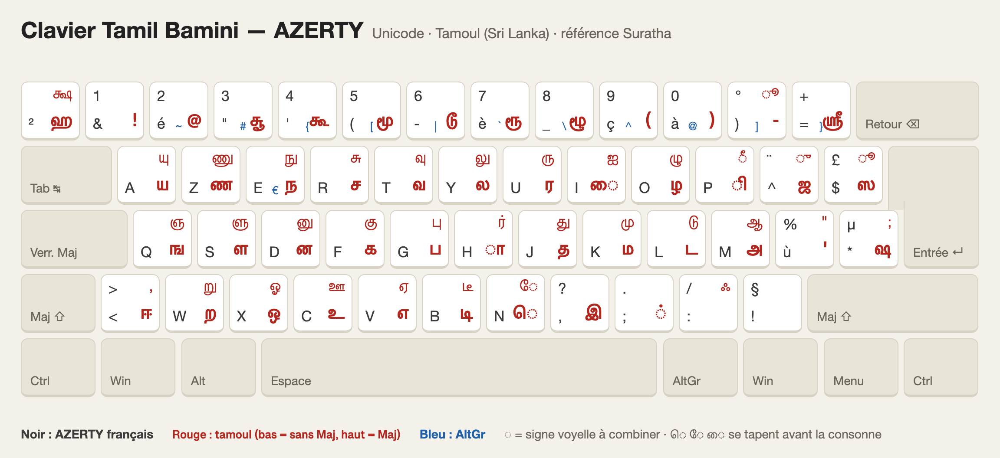

# Clavier Tamil Bamini (Unicode) pour Windows, AZERTY

Référence : le convertisseur Bamini de Suratha (https://suratha.com/reader.htm).
Une frappe Bamini donne le même texte que ce convertisseur (vérifié sur 19 phrases, ex. ``[d;dy; N`hl;ly;`` → ஜன்னல் ஹோட்டல்).



*Noir : AZERTY français · Rouge : tamoul (bas = sans Maj, haut = Maj) · Bleu : AltGr.
L'image est générée par `python3 generer_image.py` à partir de la même table que le clavier.*

## Fichiers

| Fichier | Rôle |
|---|---|
| `Tamil-Bamini-AZERTY.klc` | Source pour **Microsoft Keyboard Layout Creator** (installation native Windows) |
| `keyman/source/` | Source et paquet **Keyman** (`.kmn`, `.kps`) (recommandé : gère l'ordre des voyelles ெ ே ை) |
| `generer_image.py` | Redessine `docs/clavier-azerty.png` depuis la même table (nécessite Google Chrome) |
| `generer_bamini.py` | Régénère les deux fichiers à partir d'une seule table (modifiez `KEYS` puis lancez `python generer_bamini.py`) |

## Le point important : ெ ே ை

En Bamini on tape le signe **avant** la consonne (`n` puis `f` → கெ), parce que c'est
l'ordre d'affichage. En Unicode, l'ordre stocké est l'inverse : க + ெ.

* **Keyman** remet automatiquement dans le bon ordre : on tape exactement comme en Bamini
  (`nf` → கெ, `nfh` → கொ, `Nfh` → கோ, `if` → கை, `nfs` → கௌ).
* **MSKLC** ne sait pas réordonner : il faut taper la consonne d'abord (`fn` → கெ, `fn` puis `h`
  ne donne pas கொ). C'est la limite d'un clavier Windows natif.

## Option A : Keyman (recommandé)

1. Installer **Keyman for Windows** (gratuit) : https://keyman.com/windows/
2. Télécharger `tamil_bamini_azerty.kmp` dans les [Releases](https://github.com/SitpiRajendran/tamil-bamini-keyboard/releases), puis double-cliquer dessus → **Installer**. Langue : Tamoul (Sri Lanka).
3. Basculer de clavier avec **Win + Espace**. Test : `mk;kh` → அம்மா.

Le `.kmp` se compile sans Windows avec le compilateur Keyman en ligne de commande :

```bash
python3 generer_bamini.py
cd keyman
npx -y @keymanapp/kmc@18 build source/tamil_bamini_azerty.kmn --out-file build/tamil_bamini_azerty.kmx
npx -y @keymanapp/kmc@18 build source/tamil_bamini_azerty.kps --out-file build/tamil_bamini_azerty.kmp
```

Sur GitHub, `.github/workflows/build-keyboard.yml` fait la même chose à chaque push
(le `.kmp` est dans les *Artifacts* du run) et publie une Release pour chaque tag `v*`.

## Option B : MSKLC (natif Windows)

1. Installer **Microsoft Keyboard Layout Creator 1.4** (site Microsoft). Sous Windows 10/11, il peut
   demander d'activer **.NET Framework 3.5** dans « Fonctionnalités de Windows ».
2. *File → Load Source File…* → `Tamil-Bamini-AZERTY.klc`.
3. *Project → Validate Layout*, puis *Project → Build DLL and Setup Package*.
4. Lancer le `setup.exe` généré, redémarrer la session, puis ajouter le clavier
   dans *Paramètres → Heure et langue → Langue* (Tamoul (Sri Lanka)).

## Disposition (AZERTY)

Les lettres suivent l'étiquette de votre clavier AZERTY.

| Touche | Normal | Maj | | Touche | Normal | Maj |
|---|---|---|---|---|---|---|
| A | ய | யு | | Q | ங | ஞ |
| Z | ண | ணு | | S | ள | ளு |
| E | ந | நு | | D | ன | னு |
| R | ச | சு | | F | க | கு |
| T | வ | வு | | G | ப | பு |
| Y | ல | லு | | H | ா | ர் |
| U | ர | ரு | | J | த | து |
| I | ை | ஐ | | K | ம | மு |
| O | ழ | ழு | | L | ட | டு |
| P | ி | ீ | | M | அ | ஆ |
| W | ற | று | | X | ஒ | ஓ |
| C | உ | ஊ | | V | எ | ஏ |
| B | டி | டீ | | N | ெ | ே |
| ^ | ஜ | ு | | $ | ஸ | ூ |
| * | ஷ | ; | | ù | ' | " |
| , | இ | ? | | ; | ் | . |
| : | : | ஃ | | ! | ! | § |
| < | ஈ | , | | ² | ஹ | க்ஷ |
| = | ஸ்ரீ | + | | ) | - | ூ |

Rangée des chiffres, comme en AZERTY : **Maj ou Verr. Maj + touche = chiffre**. Sans Maj :
& `!` · é `@` · " சூ · ' கூ · ( மூ · - டூ · è ரூ · _ ழூ · ç `(` · à `)`

**AltGr** comme sur l'AZERTY français : é `~` · " `#` · ' `{` · ( `[` · - `|` · è `` ` `` · _ `\` · ç `^` · à `@` · ) `]` · = `}` · E `€`

## Combinaisons Suratha (Keyman)

| Frappe | Résultat |
|---|---|
| `n` + consonne + `h` / `N` + consonne + `h` | கொ / கோ |
| `n` + consonne + `s` | கௌ |
| forme en ு + `h`, `}` ou `+` (`Sh`, `Z}`, `A+`) | ளூ, ணூ, யூ |
| consonne + `+` (`G+`) | பூ |
| `h` + `p` / `P` / `;` (ா a la forme de ர) | ரி / ரீ / ர் |
| `x` + `s` | ஔ |

## Licence

MIT, voir [LICENSE](LICENSE).
